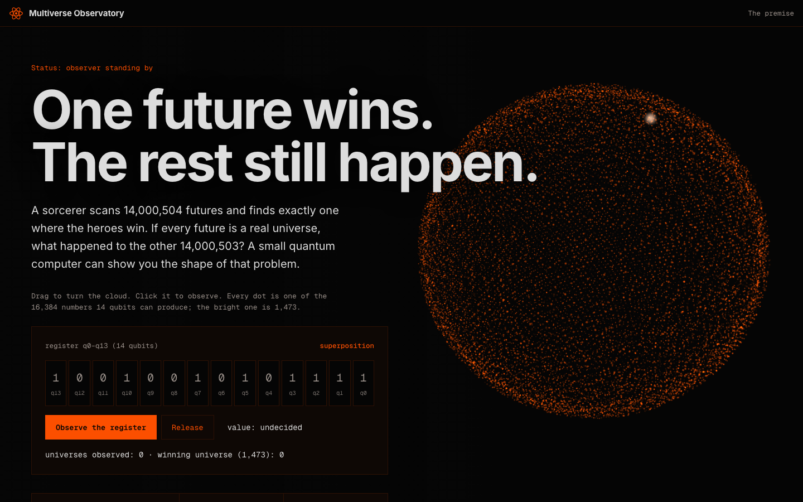

# Multiverse Observatory

> An interactive explainer of superposition, measurement and the many-worlds interpretation, built around a 14-qubit circuit. One scrolling page, a 3D cloud of all 16,384 outcomes, and five exhibits you can poke at.



Built by [Anas Aslam](https://github.com/4pfanas) as a portfolio piece. Everything runs in the browser. There is no build step, no framework and no backend.

## What it is

The page asks one question: if a sorcerer scans 14,000,504 possible futures and finds exactly one where the heroes win, what happens to the other 14,000,503? It uses that story to teach how a small quantum computer behaves.

It walks through ten sections, in order:

| # | Section (`id`) | What you get |
| --- | --- | --- |
| 01 | The premise (`premise`) | Hero headline, a 3D point cloud of the 16,384 numbers 14 qubits can produce (the bright dot is 1,473), and a live **register** of 14 qubits you can observe and release |
| 02 | Superposition (`superposition`) | Why a register is "everywhere, until you look" |
| 03 | Measurement (`measurement`) | Looking forces a single answer |
| 04 | Interpretations (`interpretations`) | What actually happens when you measure, compared across views |
| 05 | The tree (`tree`) | A branching decision tree: find the one winning branch |
| 06 | Qubit lab (`qubit-lab`) | Every qubit doubles the outcomes |
| 07 | Circuit (`circuit`) | Drag gates to build the 14-qubit circuit |
| 08 | Experiment (`experiment`) | Run shots and see how rarely the winning world shows up |
| 09 | Physics (`physics`) | What the story simplifies |
| 10 | Sources (`sources`) | Where this comes from, and what was corrected |

## Where the information comes from

The idea, the circuit and the framing come from one article:

**Dr. Alexis Kirke, "How Thanos Won the Endgame: Using a Quantum Computer to Simulate Dr. Strange's Many Worlds"**, Medium.
<https://alexiskirke.medium.com/how-thanos-won-the-endgame-using-a-quantum-computer-to-simulate-dr-stranges-many-worlds-666528aeab16>

This project is an independent reworking. It is not affiliated with the author or any studio. The theme and characters are original: it uses a generic "observer" and "winning universe" instead of any film characters, names or artwork.

## Corrections to the source article

Every number in the article was recalculated. The site uses the corrected values below.

| Quantity | Article | This site | How it is worked out |
| --- | --- | --- | --- |
| Per-shot advantage of the 14-qubit machine over the 14,000,504-world multiverse | 846× | **854.5×** | 14,000,504 ÷ 16,384 = 854.52… |
| Expected winning observations per 4,096-shot submission, compared with that multiverse | ≈ 3.5 million× | **3,500,126×** | (14,000,504 ÷ 16,384) × 4,096 = 14,000,504 ÷ 4 |
| Range of outputs from 14 qubits | 1 to 16,384 | **0 to 16,383** | 14 bits run from `00000000000000` to `11111111111111` |
| Chance one 4,096-shot submission contains at least one hit on the target number | not given | **22.1%** | 1 − (1 − 1/16,384)^4,096 ≈ 1 − e^−0.25 |
| Who was born in 1473 | Kepler | **Copernicus** | Copernicus 1473, Kepler 1571 |
| Qubits needed to hold 14,000,504 outcomes | 24 | 24 (confirmed) | 2^23 = 8,388,608 is too small, 2^24 = 16,777,216 fits |

### Physics notes added on the site

Section 09 explains these instead of leaving the article's simplifications in place:

- A 14-qubit register in superposition does not give you 16,384 readable numbers. A measurement returns one 14-bit result.
- In the many-worlds interpretation, branches carry amplitudes and probabilities follow from them. Counting universes to decide "who wins" is a story device, not how the theory assigns likelihood.
- H on every qubit followed by measurement is a uniform random number generator. It is not a quantum speed-up for finding a marked number.

## What is simulated

Each "shot" draws a uniform random 14-bit integer, which is what an ideal H-on-all-wires-then-measure circuit outputs. No real quantum hardware is involved and no noise is modelled.

## Tech

- Plain HTML, CSS and JavaScript (no bundler, no package manager).
- [three.js](https://threejs.org/) r128, loaded from cdnjs, for the 3D outcome cloud.
- Google Fonts: Inter (text) and Geist Mono (readouts). The page still works if the fonts fail to load.
- Respects `prefers-reduced-motion`.

## Run it

It is a static site. Open `index.html` directly, or serve the folder:

```bash
npx serve .
# or
python3 -m http.server 8000
```

An internet connection is needed for three.js and the fonts.

## Deploy

Drag the folder into Vercel, or from the folder run `vercel` (add `--prod` for production). Any static host works.

## Project structure

```
index.html        the ten sections and the sidebar
css/style.css     design tokens and components
css/stage.css     the 3D stage and hero layout
js/app.js         all interactive exhibits (register, tree, qubit lab, circuit builder, experiment, 3D cloud)
docs/screenshots  images used in this README
```

## Design

Dark, flat and square-cornered, with a single signal-orange accent (`#FC4F00`), Inter for text and Geist Mono for readouts. The tokens were adapted from the Zirka design system notes, with an observatory theme in place of its defense-system content.

## Credit and licence

Concept and numbers: Dr. Alexis Kirke's article (linked above), corrected as described. Site design and code: Anas Aslam. No licence has been chosen yet, so all rights are reserved.
